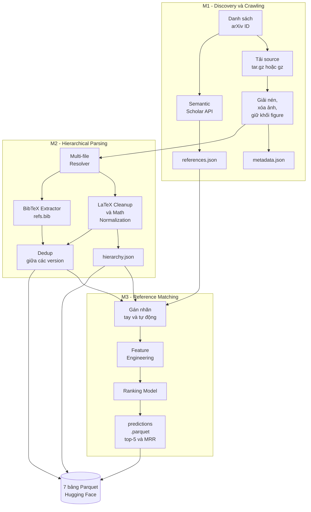

# 📚 arXiv Pipeline: Crawl – Parse – Match

> **Đồ án Khoa học Dữ liệu (HCMUS)**: Xây dựng hệ thống end-to-end tự động tải bài báo khoa học từ arXiv, đọc hiểu cấu trúc của từng bài, rồi dùng Machine Learning để tìm xem mỗi tài liệu tham khảo trong bài thực chất là bài báo nào trên arXiv.
>
> 🔗 Trang môn học: <https://hcmus-cs-ta.github.io/lab-book/intro-ds/>         
> 🔗 Drive đồ án: <https://drive.google.com/drive/u/0/folders/1ePIykL0AaKSXwHjYAjUykROtzT1lmxoP>

---

## 👋 Giới thiệu

### Dự án này làm gì?

Tưởng tượng arXiv là một thư viện chứa hàng triệu bài báo khoa học. Mỗi bài có phần mã nguồn và cuối bài có danh sách **tài liệu tham khảo**.

Dự án của nhóm làm 3 việc nối tiếp nhau:

| Bước | Tên | Ví dụ đời thường | Kết quả |
|---|---|---|---|
| **M1** | **Crawling** (thu thập) | Đi thư viện *photocopy* 25.000 cuốn sách về nhà | Thư mục chứa mã nguồn + metadata từng bài |
| **M2** | **Parsing** (phân tích cấu trúc) | *Đọc* từng cuốn và lập **mục lục dạng cây**: Chương → Mục → Câu → Công thức | File `hierarchy.json` (cây phân cấp) và `refs.bib` |
| **M3** | **Reference Matching** (ghép tài liệu tham khảo) | Thấy dòng "Smith et al., 2019, Deep Learning…" và **tìm đúng cuốn sách đó** trong thư viện | Bảng dự đoán top-5 bài khớp nhất cho mỗi tham khảo |

Cuối cùng, toàn bộ dữ liệu được đóng gói thành **7 bảng Parquet** và đăng lên **Hugging Face** để người khác dùng.

### Bài toán

Mỗi tham khảo trong bài báo thường là một chuỗi chữ lộn xộn, sai khác nhiều kiểu: viết tắt tên tác giả, thiếu năm, sai chính tả. Máy tính không thể chỉ so sánh chuỗi bằng `==`. Vì vậy ta cần **Machine Learning** để chấm điểm mức độ giống nhau và **xếp hạng** các ứng viên.

### Mục tiêu

- Thu thập dữ liệu có đạo đức (tôn trọng giới hạn truy cập của máy chủ)
- Xử lý văn bản bán cấu trúc (LaTeX) bằng regex và xây cây dữ liệu
- Làm sạch và khử trùng lặp dữ liệu (deduplication)
- Feature engineering và mô hình xếp hạng (ranking), đánh giá bằng MRR
- Làm việc nhóm chuẩn: Git, Pull Request, Code Review, CI

> 💡 **Gặp từ lạ?** Xem [Bảng thuật ngữ](#-17-bảng-thuật-ngữ-glossary) ở cuối README.

---

## 📑 Mục lục

1. [Kiến trúc hệ thống & Pipeline](#-1-kiến-trúc-hệ-thống--pipeline)
2. [Tech Stack](#-2-tech-stack)
3. [Cấu trúc thư mục](#-3-cấu-trúc-thư-mục)
4. [Thành viên & Phân công](#-4-thành-viên--phân-công)
5. [Task breakdown & Timeline](#-5-task-breakdown--timeline)
6. [Quy trình làm việc & Git flow](#-6-quy-trình-làm-việc--git-flow)
7. [API Reference](#-7-api-reference)
8. [Biến môi trường](#-8-biến-môi-trường)
9. [Cài đặt (venv / conda)](#-9-cài-đặt-venv--conda)
10. [Chạy chương trình](#-10-chạy-chương-trình)
11. [Testing](#-11-testing)
12. [Quản lý dữ liệu](#-12-quản-lý-dữ-liệu)
13. [Đặc tả dữ liệu đầu ra](#-13-đặc-tả-dữ-liệu-đầu-ra)
14. [Troubleshooting](#-14-troubleshooting)
15. [Quy chế & Liêm chính học thuật](#-15-quy-chế--liêm-chính-học-thuật)
16. [Lưu ý quan trọng](#-16-lưu-ý-quan-trọng)
17. [Bảng thuật ngữ (Glossary)](#-17-bảng-thuật-ngữ-glossary)
18. [Trích dẫn & Tài liệu tham khảo](#-18-trích-dẫn--tài-liệu-tham-khảo)

---

## 🏗 1. Kiến trúc hệ thống & Pipeline

### 1.1 Sơ đồ tổng quan



### 1.2 Nguyên tắc thiết kế

**① Interface-Driven Development (IDD)**: Nhóm chốt **schema dữ liệu** (`src/schemas.py`) ngay từ Tuần 1 và dùng `tests/make_mock.py` sinh **dữ liệu giả** nhỏ nhẹ. Nhờ đó người làm M2 (parser) và M3 (ML) có thể code song song ngay, không phải ngồi chờ M1 crawl xong.

```
Không có IDD:  M1 xong ──► M2 mới bắt đầu ──► M3 mới bắt đầu     (nối đuôi, chậm)
Có IDD:        M1 ──────────────────►
               M2 (dùng mock) ──────►      cùng lúc
               M3 (dùng mock) ──────►
```

**② Repo không chứa dữ liệu thật.** Mã nguồn nằm trên GitHub, còn 25.000 bài thật nằm trên Google Drive chung hoặc Hugging Face Private (xem [mục 12](#-12-quản-lý-dữ-liệu)).

**③ Báo cáo Jupyter Book ở repo riêng** (`book-repo/`). Pipeline chỉ xuất file thống kê nhẹ `summary_stats.json` để commit sang đó; Notebook trong Book đọc file này và vẽ biểu đồ khi build trên GitHub Actions.

### 1.3 Luồng dữ liệu chi tiết

**Step 1 – M1: Discovery & Crawling**
1. Discovery: so sánh arXiv API (batch ID), OAI-PMH và Kaggle dataset; chọn phương pháp và đo tổng thời gian.
2. Tải **mọi version** (v1, v2, …) qua `export.arxiv.org/src/{id}v{n}`.
3. Nhận diện `.tar.gz` và `.gz` đơn (chứa `.tex`); **xóa ảnh nhưng giữ lệnh `\begin{figure}`**; ghi log `size_before` / `size_after`.
4. Bài chỉ có PDF/Word → giữ **record rỗng** và ghi log lỗi.
5. Gọi Semantic Scholar lấy danh sách tham khảo, **bỏ các ref không có arXiv ID**.
6. Hỗ trợ CLI độc lập `--id_start --id_end` và **Checkpoint/Resume** (chạy lại sẽ tiếp tục từ chỗ dừng).

**Step 2 – M2: Hierarchical Parsing**
1. **Multi-file Resolver**: tìm file `.tex` chính, lần theo `\input{}` / `\include{}` để ghép toàn bộ nội dung.
2. **LaTeX Cleanup & Math Normalization** (xóa `\centering`, `[htpb]`…; chuẩn hóa toán): chạy **TRƯỚC** khi dedup.
3. **Hierarchy Tree**: dựng cây Chapter → Section → Subsection → … với thuộc tính `kind`.
4. **BibTeX Extractor**: trích `\bibitem` thành `refs.bib`, chuẩn hóa trường.
5. **Dedup 2 cấp**: gộp BibTeX trùng (Field Union) + so khớp nội dung giữa các version.

**Step 3 – M3: Reference Matching**
1. Gán nhãn (thủ công + tự động) → chia Train / Valid / Test.
2. Feature Engineering (Levenshtein, Jaccard n-gram, TF-IDF cosine).
3. Train Ranking Model → xuất top-5 ứng viên → đo **MRR** trên tập Test.
4. Xuất 7 bảng Parquet → upload Hugging Face.

---

## 🧰 2. Tech Stack

| Nhóm | Công cụ | Dùng để |
|---|---|---|
| Ngôn ngữ | **Python 3.11** | Toàn bộ pipeline |
| Crawling | `arxiv`, `sickle` (OAI-PMH), `requests` | Discovery & tải source |
| Dữ liệu | `pandas`, `numpy`, `pyarrow` | Xử lý bảng, ghi Parquet |
| Schema | `pydantic` v2 | Khai báo & kiểm tra kiểu dữ liệu |
| Parsing | `re` (regex), `bibtexparser` | Phân tích LaTeX/BibTeX |
| ML | `scikit-learn`, `rapidfuzz` | TF-IDF, Levenshtein, Ranking |
| Giám sát | `psutil` | Đo RAM, đĩa, thời gian |
| Hosting | `huggingface_hub` | Upload dataset |
| Báo cáo | `jupyter-book` + GitHub Pages | Báo cáo M1, M2 |
| Chất lượng | `pytest`, `pytest-cov`, `ruff` | Test & kiểm tra style |
| CI/CD | GitHub Actions | Tự chạy test mỗi PR |
| Cộng tác | GitHub, Discord, Google Drive | Code, họp, lưu data |
| Benchmark | Google Colab (CPU-only) | Đo hiệu năng chuẩn |

---

## 🗂 3. Cấu trúc thư mục

```
arxiv-pipeline/
├── README.md                    # Tài liệu này
├── CONTRIBUTING.md              # Quy tắc đóng góp
├── requirements.txt             # Thư viện Python
├── pytest.ini                   # Cấu hình pytest
├── .env.example                 # Mẫu biến môi trường (copy thành .env)
├── .gitignore                   # Chặn data thật, secrets, cache
│
├── configs/
│   └── config.yaml              # Tham số: delay, retry, đường dẫn, top_k
│
├── src/                         # ★ Mã nguồn chính
│   ├── main.py                  # Pipeline Runner (CLI)                    [P3-01]
│   ├── schemas.py               # Pydantic schema cho 7 bảng               [P1-02]
│   ├── common/
│   │   └── utils_io.py          # Checkpoint, đọc/ghi JSON, logging
│   ├── m1_crawling/
│   │   ├── crawler.py           # Tải source arXiv                         [P2-01]
│   │   ├── s2_api.py            # Semantic Scholar → references.json       [P2-02]
│   │   └── profiler.py          # Đo RAM / đĩa / thời gian                 [P2-02]
│   ├── m2_parsing/
│   │   ├── latex_parser.py      # Multi-file Resolver                      [P2-03]
│   │   ├── tree_builder.py      # Dựng hierarchy.json                      [P2-03]
│   │   ├── latex_cleanup.py     # Dọn LaTeX, chuẩn hóa toán                [P2-05]
│   │   ├── bibtex_extractor.py  # \bibitem → refs.bib                      [P2-04]
│   │   └── dedup.py             # Dedup BibTeX + full-text                 [P2-04]
│   └── m3_matching/
│       ├── features.py          # Tiền xử lý & đặc trưng                   [P2-06]
│       ├── matching_model.py    # Mô hình ranking                          [P2-06]
│       ├── train.py             # Huấn luyện + xuất predictions            [P4-01]
│       ├── evaluate.py          # Tính MRR                                 [P4-01]
│       └── export_parquet.py    # Xuất 7 bảng + upload HF                  [P4-02]
│
├── tests/                       # Cấu trúc phản chiếu src/
│   ├── make_mock.py             # Sinh dữ liệu giả                         [P1-02]
│   ├── mock_data/               # Mock nhỏ (ĐƯỢC commit)
│   ├── common/  m1_crawling/  m2_parsing/  m3_matching/
│
├── docs/                        # Tài liệu thiết kế (spec)
│   ├── discovery_report.md      # So sánh phương pháp discovery            [P1-00]
│   ├── latex_spec.md            # Quy tắc dựng cây                         [P1-04]
│   └── ml_design.md             # Thiết kế ML & predictions                [P1-05]
│
├── data/                        # ⚠ Nội dung bị gitignore (chỉ giữ .gitkeep)
│   ├── raw/  processed/  labels/  sources/
│
├── reports/                     # Benchmark JSON, poster A2
├── scripts/setup_dev.sh         # Cài môi trường một lệnh (Linux/macOS)
└── .github/
    ├── pull_request_template.md # Mẫu mô tả PR
    └── workflows/ci.yml         # CI: ruff + pytest
```

> 📌 **Thư mục theo từng bài báo** (đầu ra của M1/M2, dự kiến): `data/processed/<yymm-id>/` chứa `metadata.json`, `references.json`, `hierarchy.json`, `refs.bib`… (tên `yymm-id`, ví dụ `2506-00788`; bài cũ như `hep-th/9901001` được giữ theo quy ước của đề).

> 🔖 `.gitkeep` là file rỗng giúp Git giữ lại thư mục trống (Git không theo dõi thư mục rỗng).

---

## 👥 4. Thành viên & Phân công

Mỗi người **crawl và parse 5.000 bài** trên một dải ID riêng (tổng **25.000 bài**), và đều tham gia gán nhãn thủ công để hiểu trọn pipeline khi bảo vệ Poster.

| Thành viên | Dải ID cá nhân | Vai trò Lead | Nhiệm vụ chính |
|---|---|---|---|
| **Tôn Thất Kiên** | 2025-06 (788 → 5787) | Discovery & Crawling (M1) | Khảo sát Discovery (P1-00), Crawler (P2-01), LaTeX Cleanup (P2-05), Báo cáo M1, Poster |
| **Phạm Gia Bảo** | 2025-03 (16914 → 21913) | External API & Storage (M1, M3) | Schema & Mock (P1-02), S2 API & Profiler (P2-02), Benchmark M1, Feature Eng, HF Exporter (P4-02) |
| **Trần Ngô Uyên Nhi** | 2025-02/03 (18235 → 1913) | Hierarchical Parser (M2) | Khung Jupyter Book (P1-03), Resolver & Tree Builder (P2-03), Báo cáo M2, Benchmark M2 |
| **Đinh Công Khang** | 2024-11 (3799 → 8798) | Dedup & BibTeX (M2) | Spec LaTeX (P1-04), BibTeX & Dedup (P2-04), Runner `main.py` (P3-01) |
| **Trần Tuấn Kiệt** | 2024-10 (13025 → 18024) | Machine Learning (M3) | Repo GitHub (P1-01), Spec ML (P1-05), Ranking Model, MRR, README spec, Poster |

> ⚠️ **Nhi**: dải ID `18235 → 1913` đi qua hai tháng (2025-02 và 2025-03). Cả nhóm cần thống nhất rõ cách xử lý đoạn "quay vòng" này trước khi chạy crawl để không bị trùng/sót ID.

### Cơ chế Review chéo

Mỗi task có **1 Owner + 2 Reviewers** (xem bảng task ở mục 5). Owner viết code, 2 Reviewer đọc và Approve PR trước khi merge. Đây vừa là kiểm soát chất lượng vừa giúp mọi người hiểu code của nhau.

---

## 📋 5. Task breakdown & Timeline

### 5.1 Các mốc nộp

| Milestone | Nội dung | Hạn Moodle | **Hạn nội bộ (mục tiêu)** | Dư an toàn |
|---|---|---|---|---|
| **M1** | Discovery & Crawling | 06/11 | **02/11** | 4 ngày |
| **M2** | Hierarchical Parsing | 20/11 | **12/11** | 8 ngày |
| **M3** | Reference Matching & Poster | 27/11 | **22/11** | 5 ngày |

> ⏰ Hạn nội bộ sớm hơn hạn Moodle để có đệm xử lý rủi ro (lỗi mạng, merge conflict, in poster).

### 5.2 Timeline tổng quan

```
Tuần  12/10 ─ 15/10 : Giai đoạn 1 – Khảo sát, Repo, Schema, Spec
      14/10 ─ 25/10 : Giai đoạn 2 – Viết module (crawler, parser, ML)
      22/10 ─ 28/10 : ĐỢT 1 – Crawl thật 25.000 bài
      29/10 ─ 02/11 : Benchmark Colab M1 + Báo cáo M1  ──► NỘP M1
      30/10 ─ 06/11 : ĐỢT 2 – Parse thật 25.000 bài
      07/11 ─ 12/11 : Benchmark Colab M2 + Báo cáo M2  ──► NỘP M2
      31/10 ─ 08/11 : Gán nhãn dữ liệu
      08/11 ─ 14/11 : Train model, xuất predictions
      15/11 ─ 18/11 : Upload Hugging Face
      15/11 ─ 20/11 : Thiết kế Poster A2
      20/11 ─ 22/11 : Kiểm thử cuối + NỘP M3
```

### 5.3 Danh sách 24 task

**Trạng thái:** 🔴 Chưa sẵn sàng · 🟡 Đang thực hiện · 🟢 Hoàn thành *(cập nhật trong bảng quản lý tiến độ của nhóm)*

#### Giai đoạn 1 – Nền móng (12/10 → 15/10)

| ID | Task | Owner | Reviewers | Thời gian | Phụ thuộc |
|---|---|---|---|---|---|
| P1-00 | Khảo sát Discovery & phương pháp crawl | Kiên | Bảo, Khang | 12/10 – 14/10 | – |
| P1-01 | Tạo repo GitHub & khung dự án | Kiệt | Kiên, Khang | 12/10 – 13/10 | – |
| P1-02 | Data Schema & Mock Generator | Bảo | Kiệt, Nhi | 12/10 – 15/10 | – |
| P1-03 | Khung Jupyter Book (repo riêng) | Nhi | Kiên, Khang | 12/10 – 15/10 | – |
| P1-04 | Khảo sát LaTeX & Spec Tree | Khang | Nhi, Kiệt | 12/10 – 15/10 | – |
| P1-05 | Thiết kế kiến trúc ML & Predictions Spec | Kiệt | Bảo, Nhi | 12/10 – 15/10 | – |

#### Giai đoạn 2 – Viết module (14/10 → 25/10)

| ID | Task | Owner | Reviewers | Thời gian | Phụ thuộc |
|---|---|---|---|---|---|
| P2-01 | Module Crawling arXiv | Kiên | Bảo, Kiệt | 14/10 – 20/10 | P1-00, P1-02 |
| P2-02 | Module S2 API & Profiler | Bảo | Kiên, Nhi | 16/10 – 22/10 | P1-02 |
| P2-03 | Multi-file Resolver & Tree Builder | Nhi | Khang, Kiệt | 16/10 – 23/10 | P1-02, P1-04 |
| P2-05 | LaTeX Cleanup & Normalization | Kiên | Khang, Bảo | 16/10 – 23/10 | P1-02, P1-04 |
| P2-04 | BibTeX Extractor & 2-level Dedup | Khang | Nhi, Kiệt | 16/10 – 25/10 | P1-02, P1-04, P2-03, P2-05 |
| P2-06 | Preprocessing & Feature Engineering | Kiệt & Bảo | Khang, Kiên | 16/10 – 23/10 | P1-02, P1-05 |

#### Giai đoạn 3 – Chạy dữ liệu thật & Benchmark

| ID | Task | Owner | Reviewers | Thời gian | Phụ thuộc |
|---|---|---|---|---|---|
| P3-01 | Đóng gói Pipeline Runner (`main.py`) | Khang | Kiên, Nhi | 26/10 – 28/10 | P2-01..05 |
| P3-02a | **Crawl thật M1** (25.000 bài) | Cả 5 | Kiên, Bảo | 22/10 – 28/10 | P2-01, P2-02 |
| P3-02b | Colab Benchmark M1 & Summary Export | Bảo | Kiên, Kiệt | 29/10 – 30/10 | P3-02a |
| P3-03a | **Parse thật M2** (25.000 bài) | Cả 5 | Nhi, Khang | 30/10 – 06/11 | P3-01, P3-02a |
| P3-03b | Colab Benchmark M2 & Parse Summary | Nhi | Khang, Kiệt | 07/11 – 08/11 | P3-03a |
| P3-07 | Gán nhãn Reference Matching | Cả 5 | Kiệt, Bảo | 31/10 – 08/11 | P1-05, P1-02, P3-03a |

#### Giai đoạn 4 – Báo cáo, ML, Hugging Face, Poster

| ID | Task | Owner | Reviewers | Thời gian | Phụ thuộc |
|---|---|---|---|---|---|
| P4-03a | Báo cáo Jupyter Book M1 & README update | Kiên & Bảo | Nhi, Kiệt | 30/10 – 02/11 | P3-02b |
| P4-03b | Báo cáo Jupyter Book M2 | Nhi & Khang | Kiên, Bảo | 08/11 – 12/11 | P3-03b |
| P4-01 | Huấn luyện model & đo MRR Top-5 | Kiệt | Bảo, Khang | 08/11 – 14/11 | P2-06, P3-07, P3-03a |
| P4-02 | Xuất 7 bảng Parquet & upload Hugging Face | Bảo | Kiệt, Khang | 15/11 – 18/11 | P3-03a, P4-01 |
| P4-04 | Thiết kế Poster A2 & Documentation | Kiên & Kiệt | Bảo, Khang | 15/11 – 20/11 | P4-01, P4-03b |
| P4-05 | Benchmark cuối & nộp Moodle | Cả 5 | Kiên, Nhi | 20/11 – 22/11 | P4-01..04 |

> 💡 **Cột "Phụ thuộc"** nghĩa là: task này chỉ bắt đầu đầy đủ khi các task trong cột đó đã xong. Nhờ mock data (IDD), nhiều task giai đoạn 2 vẫn có thể bắt đầu sớm dù M1 chưa crawl xong.

### 5.4 Sản phẩm cần nộp trên Moodle

| Milestone | Nộp gì |
|---|---|
| M1 | Link Code Repo (không có data) + Link Book Repo riêng + báo cáo M1 |
| M2 | Link báo cáo Jupyter Book M2 |
| M3 | Poster A2 `.pptx` (420 × 594 mm, dọc) + Link Hugging Face + Link Code Repo |

---

## 🔀 6. Quy trình làm việc & Git flow

### 6.1 Giao tiếp

- **Họp sync:** 1 buổi/tuần, **Chủ Nhật 20:00** qua Discord.
- **Cập nhật hằng ngày:** nhắn **1 câu ngắn** vào channel Discord nhóm (làm gì / vướng gì).

### 6.2 Git flow

```
main  ●───────●──────────●─────────●        ← luôn chạy được, chỉ merge qua PR
       \     /  \       /  \       /
        ●───●    ●─────●    ●─────●        ← feature/<TASK-ID>-<mô-tả>
```

**Từng bước làm một task** (ví dụ P2-01):

```bash
# 1. Cập nhật main
git checkout main
git pull origin main

# 2. Tạo nhánh riêng cho task
git checkout -b feature/P2-01-crawler

# 3. Code, rồi commit nhỏ & thường xuyên
git add src/m1_crawling/crawler.py
git commit -m "P2-01: thêm hàm crawl_paper với retry"

# 4. Đẩy nhánh lên GitHub
git push -u origin feature/P2-01-crawler

# 5. Mở Pull Request trên GitHub → gán đúng 2 Reviewers theo bảng task
# 6. Sửa theo góp ý → khi đủ 2 Approve mới được Merge vào main
```

### 6.3 Quy tắc bắt buộc

| ✅ Nên | ❌ Không |
|---|---|
| Mỗi task một nhánh `feature/<TASK-ID>-...` | Push thẳng lên `main` |
| PR phải có **đủ 2 Reviewers Approve** | Tự merge khi chưa đủ duyệt |
| Commit message bắt đầu bằng task ID | Commit "update", "fix" mơ hồ |
| Chạy `pytest` trước khi mở PR | Commit khi test đang đỏ |
| Ghi citation khi tham khảo code/tài liệu | Chép code không dẫn nguồn |
| Dùng `.env` cho API key | **Commit API key / data thật** |

> 🛡 Gợi ý: bật **Branch protection** cho `main` (Settings → Branches): yêu cầu PR và 2 approvals.

### 6.4 Checklist khi review PR

- [ ] Code đúng yêu cầu của task (xem cột "Detail" trong bảng tiến độ)
- [ ] Có test, test pass trên mock data
- [ ] Không có data thật / API key
- [ ] Có docstring và citation nếu cần
- [ ] Tuân thủ quy định crawler (delay, User-Agent)

---

## 🔌 7. API Reference

### 7.1 API bên ngoài

#### arXiv Source – tải mã nguồn bài báo

| | |
|---|---|
| **URL** | `https://export.arxiv.org/src/{id}v{n}` (ví dụ `.../src/2506.00788v1`) |
| **Trả về** | File `.tar.gz` (nhiều file) hoặc `.gz` (một file `.tex`) |
| **Giới hạn** | **≥ 3 giây giữa 2 request**, **1 kết nối tại một thời điểm** |
| **Bắt buộc** | `User-Agent` mô tả rõ (tên dự án + email liên hệ) |
| **Cấm** | ❌ Không dùng domain `arxiv.org` để tải; chỉ dùng `export.arxiv.org` |

```python
import requests, time

headers = {"User-Agent": "DS-Project-HCMUS/1.0 (mailto:ban@student.hcmus.edu.vn)"}
resp = requests.get("https://export.arxiv.org/src/2506.00788v1", headers=headers, timeout=60)
time.sleep(3)  # BẮT BUỘC ≥ 3 giây
```

#### Semantic Scholar (S2) – lấy danh sách tham khảo

| | |
|---|---|
| **URL** | `https://api.semanticscholar.org/graph/v1/paper/arXiv:{id}/references` |
| **Xác thực** | Header `x-api-key: <S2_API_KEY>` |
| **Giới hạn** | Delay **1 giây** giữa các request; gặp lỗi **HTTP 429** thì chờ rồi thử lại |
| **Lọc** | **Bỏ** các tham khảo không có arXiv ID |

```python
url = "https://api.semanticscholar.org/graph/v1/paper/arXiv:2506.00788/references"
params = {"fields": "title,externalIds", "limit": 1000}
resp = requests.get(url, params=params, headers={"x-api-key": S2_API_KEY})
# Giữ lại ref có externalIds["ArXiv"]
```

> 📎 Kiểm tra lại tên field và giới hạn tại tài liệu chính thức của S2 trước khi code, vì API có thể thay đổi.

#### Discovery – 3 phương pháp cần so sánh (P1-00)

| Phương pháp | Mô tả ngắn |
|---|---|
| **arXiv API (batch ID)** | Truy vấn trực tiếp theo danh sách ID |
| **OAI-PMH** (qua `sickle`) | Giao thức chuẩn thu hoạch metadata hàng loạt |
| **Kaggle dataset** | Tải dataset arXiv có sẵn |

Kết quả so sánh, lý do chọn và thời gian đo được ghi trong `docs/discovery_report.md`.

#### Hugging Face Hub

Dùng `huggingface_hub` để upload 7 bảng Parquet và Dataset Card. Cần `HF_TOKEN`. Hướng dẫn hosting chính thức xin từ Lab Instructors (task P4-02).

### 7.2 Giao diện nội bộ (module)

| Module | Hàm chính | Chức năng |
|---|---|---|
| `m1_crawling.crawler` | `crawl_paper(arxiv_id, out_dir)` | Tải & xử lý 1 bài (mọi version) |
| | `crawl_range(id_start, id_end, out_dir, resume)` | Crawl cả dải ID, có checkpoint |
| `m1_crawling.s2_api` | `fetch_references(arxiv_id)` | Lấy `references.json` |
| `m1_crawling.profiler` | `Profiler` (context manager) | Đo RAM đỉnh, time/bài, đĩa |
| `m2_parsing.latex_parser` | `find_main_tex`, `resolve_includes` | Tìm file chính, ghép `\input` |
| `m2_parsing.tree_builder` | `build_tree(latex, arxiv_id)` | Dựng `hierarchy.json` |
| `m2_parsing.latex_cleanup` | `cleanup_latex`, `normalize_math` | Dọn LaTeX, chuẩn hóa toán |
| `m2_parsing.bibtex_extractor` | `extract_bibitems(latex)` | `\bibitem` → danh sách entry |
| `m2_parsing.dedup` | `dedup_bibtex`, `dedup_fulltext` | Khử trùng lặp |
| `m3_matching.features` | `preprocess`, `build_features` | Làm sạch & tạo đặc trưng |
| `m3_matching.matching_model` | `MatchingModel.fit / .rank` | Huấn luyện & xếp hạng |
| `m3_matching.evaluate` | `mrr(ranked, truth)` | Tính MRR |
| `m3_matching.export_parquet` | `export_all(processed_dir, out_dir)` | Xuất 7 bảng |

> 🚧 Phần lớn hàm đang là **khung (stub)**, mỗi owner hiện thực theo task của mình. Chữ ký hàm có thể điều chỉnh khi code, nhưng **schema trong `src/schemas.py` phải ổn định** (xem IDD).

---

## 🔐 8. Biến môi trường

Biến môi trường là **thông tin bí mật hoặc riêng của từng người** (như API key) không được ghi cứng trong code.

| Biến | Bắt buộc | Mô tả | Lấy ở đâu |
|---|---|---|---|
| `S2_API_KEY` | ✅ | Khóa Semantic Scholar | Đăng ký trên trang Semantic Scholar API |
| `ARXIV_USER_AGENT` | ✅ | Chuỗi định danh khi gọi arXiv, ví dụ `DS-Project-HCMUS/1.0 (mailto:email@student.hcmus.edu.vn)` | Tự đặt, có email thật |
| `HF_TOKEN` | Khi upload | Token Hugging Face (quyền write) | Hugging Face → Settings → Access Tokens |

**Cách thiết lập:**

```bash
cp .env.example .env      # Windows (cmd): copy .env.example .env
# Mở .env bằng editor và điền giá trị thật
```

> 🚨 **Không bao giờ commit file `.env`.** File này đã nằm trong `.gitignore`. Nếu lỡ commit key, hãy **thu hồi (revoke) và tạo key mới ngay**.

Tham số không bí mật (delay, retry, đường dẫn, `top_k`…) nằm trong `configs/config.yaml`.

---

## ⚙️ 9. Cài đặt (venv / conda)

### 9.1 Yêu cầu

- **Python 3.11** (khuyến nghị)
- **Git**
- Kết nối internet; ~vài GB trống để thử nghiệm local (data thật lưu trên Drive)

Kiểm tra:
```bash
python --version     # hoặc python3 --version
git --version
```

### 9.2 Clone repo

```bash
git clone <URL_REPO>
cd arxiv-pipeline
```

### 9.3 Cách A – `venv` (có sẵn trong Python)

**Môi trường ảo (virtual environment)** là "căn phòng riêng" chứa thư viện của dự án, tránh xung đột với các dự án khác trên máy.

```bash
# Tạo môi trường
python -m venv .venv

# Kích hoạt
source .venv/bin/activate          # Linux / macOS
.venv\Scripts\activate             # Windows (cmd)
.venv\Scripts\Activate.ps1         # Windows (PowerShell)

# Cài thư viện
pip install --upgrade pip
pip install -r requirements.txt
```

Khi kích hoạt thành công, đầu dòng lệnh hiện `(.venv)`. Thoát bằng `deactivate`.

### 9.4 Cách B – `conda` (Anaconda / Miniconda)

```bash
conda create -n arxiv-pipeline python=3.11 -y
conda activate arxiv-pipeline
pip install -r requirements.txt
```

Thoát: `conda deactivate`. Xóa môi trường: `conda remove -n arxiv-pipeline --all`.

### 9.5 Cài nhanh bằng script (Linux/macOS)

```bash
bash scripts/setup_dev.sh
```
Script tự tạo venv, cài thư viện, tạo `.env`, sinh mock data và chạy test.

### 9.6 Hoàn tất cài đặt

```bash
cp .env.example .env               # rồi điền khóa của bạn
python tests/make_mock.py          # sinh dữ liệu giả
pytest -q                          # kiểm tra mọi thứ ổn
```

Thấy `passed` là bạn đã sẵn sàng. ✅

---

## ▶️ 10. Chạy chương trình

> Luôn **kích hoạt môi trường ảo** và chạy lệnh **từ thư mục gốc** của repo.

### 10.1 Chạy toàn bộ pipeline (M1 + M2)

```bash
python -m src.main --id_start 2506.00788 --id_end 2506.05787
```

| Tham số | Ý nghĩa |
|---|---|
| `--id_start` | arXiv ID bắt đầu của dải |
| `--id_end` | arXiv ID kết thúc của dải |
| `--config` | Đường dẫn file cấu hình (mặc định `configs/config.yaml`) |
| `--no_resume` | Bỏ qua checkpoint, chạy lại từ đầu |

**Checkpoint/Resume:** nếu chương trình bị ngắt (mất mạng, tắt máy), chỉ cần **chạy lại đúng lệnh cũ**, nó sẽ tiếp tục từ bài đang dở, không tải lại từ đầu.

### 10.2 Chạy từng module (khi phát triển)

```bash
python -m src.m3_matching.train        # huấn luyện + xuất predictions (P4-01)
```

### 10.3 Thử nhanh với dữ liệu giả (không cần mạng)

```bash
python tests/make_mock.py
pytest -q
```

### 10.4 Kế hoạch chạy dữ liệu thật

1. **Đợt 1 (22/10 → 28/10):** mỗi người crawl 5.000 bài trên dải ID cá nhân. *Crawl source trước, gọi S2 API bổ sung sau.*
2. **Đợt 2 (30/10 → 06/11):** **đóng băng parser**, rồi mỗi người parse 5.000 bài đã crawl.
3. **Đợt 3 (31/10 → 22/11):** gán nhãn → train → xuất predictions → upload HF.

> ⚠️ Chạy thật tốn thời gian (delay ≥ 3s/request × nhiều version × 5.000 bài). **Hãy chạy thử 5-10 bài trước**, rồi mới chạy cả dải.

---

## 🧪 11. Testing

**Test** là code kiểm tra code khác có chạy đúng không. Dự án dùng `pytest`.

```bash
pytest -q                              # chạy tất cả
pytest tests/m3_matching -q            # chỉ một nhóm
pytest tests/m3_matching/test_evaluate.py::test_mrr   # chỉ một test
pytest --cov=src --cov-report=term-missing            # xem độ phủ code
ruff check src tests                   # kiểm tra style/lỗi cú pháp
```

**Kết quả đọc thế nào?**
- `.` = pass · `F` = fail · `s` = skip (test chưa viết, đang `TODO`)

**Quy ước:**
- Test đặt trong `tests/`, cấu trúc **phản chiếu** `src/` (`src/m2_parsing/dedup.py` ↔ `tests/m2_parsing/test_dedup.py`).
- Test chạy trên **mock data** (`tests/mock_data/`), **không phụ thuộc mạng hay data thật**.
- Owner của module chịu trách nhiệm viết test; Reviewer kiểm tra test đủ chưa.
- **CI** (GitHub Actions) tự chạy `ruff` + `pytest` trên mọi PR. PR đỏ thì không merge.

**Ví dụ viết test:**
```python
# tests/m3_matching/test_evaluate.py
from src.m3_matching.evaluate import mrr

def test_mrr():
    # bài 1: đáp án "b" ở hạng 2 → 1/2; bài 2: không có → 0; trung bình = 0.25
    assert mrr([["a", "b"], ["x", "y"]], ["b", "z"]) == 0.25
```

---

## 💾 12. Quản lý dữ liệu

| Loại dữ liệu | Lưu ở đâu | Có commit vào GitHub không? |
|---|---|---|
| Code, docs, config | GitHub repo | ✅ Có |
| Mock data nhỏ (`tests/mock_data/`) | GitHub repo | ✅ Có |
| 25.000 bài thật (`data/processed/`) | Google Drive chung / HF Private | ❌ **Không** |
| File `.tex` / `.bib` nguồn (`data/sources/`) | Google Drive chung | ❌ **Không** |
| Nhãn `ground_truth.json` (`data/labels/`) | Google Drive chung / HF Private | ❌ **Không** |
| `summary_stats.json` (nhẹ) | `book-repo/` (repo riêng) | ✅ Có (ở repo Book) |

**Giữ lại file `.tex`/`.bib` gốc** sau khi parse để tạo bảng `sources` trên Hugging Face.

**Báo cáo Jupyter Book** build trên GitHub Actions: pipeline xuất `summary_stats.json` (M1) và `summary_stats_m2.json` (M2) → commit vào `book-repo/` → Notebook đọc & vẽ biểu đồ.

---

## 📐 13. Đặc tả dữ liệu đầu ra

### 13.1 Cây phân cấp `hierarchy.json` (M2)

- Cấp bậc tiêu đề được **tự nhận diện** (Chapter → Section → Subsection → …).
- **Lá của cây** gồm: câu (sentence), công thức khối (`$$...$$` / `equation`), hình/bảng (figure/table).
- Danh sách `itemize` là **nhánh con**.
- **Bỏ** section *References*; **giữ** *Acknowledgments* và *Appendices*.
- Mỗi element có thuộc tính `kind` (`section`, `sentence`, `formula`, `figure`, `table`, …) theo chuẩn HF elements và **ID chứa arXiv ID**.

*(Chi tiết đầy đủ ở `docs/latex_spec.md`.)*

### 13.2 Chuẩn hóa BibTeX (M2)

| Trường | Kiểu |
|---|---|
| `authors` | `list[str]` |
| `year` | `int` (có thể null) |
| `doi`, `journal`, `url` | `str` (có thể null) |

- **Field Union:** khi gộp các entry trùng, hợp nhất mọi trường thông tin có được.
- Đổi tên các `\cite{}` bị trùng key.

### 13.3 Gán nhãn & chia tập (M3)

- **Gán tay:** ≥ 5 bài (≥ 20 cặp), dựa trên parse đợt đầu M2. Mỗi thành viên gán ≥ 1 bài.
- **Gán tự động:** ≥ 10% phần còn lại.
- **Chia tập:** Test = 1 bài tay + 1 bài tự động; Valid = 1 tay + 1 tự động; Train = phần còn lại. *(Làm nhãn Train/Valid trước để có thể train sớm.)*
- Spec nhãn chi tiết được tài liệu hóa trong mục dưới (cập nhật bởi Kiệt, P1-05/P4-04).

> 📝 **Feature & Label spec:** *(TODO – Kiệt điền tại đây khi chốt: định nghĩa từng feature, lý do chọn dựa trên phân tích dữ liệu, định dạng nhãn.)*

### 13.4 Mô hình & đánh giá

- Bài toán: **xếp hạng** (ranking) các cặp (tham khảo × bài arXiv ứng viên), nhãn nhị phân Yes/No.
- Đặc trưng dự kiến: **Levenshtein**, **Jaccard n-gram**, **TF-IDF cosine**.
- Chỉ số: **MRR** (Mean Reciprocal Rank) trên tập Test.

> **MRR là gì?** Với mỗi tham khảo, nếu đáp án đúng nằm ở vị trí *k* trong danh sách dự đoán thì điểm là `1/k` (hạng 1 → 1.0, hạng 2 → 0.5, hạng 5 → 0.2, không có → 0). MRR là điểm trung bình trên mọi tham khảo; càng gần 1 càng tốt.

> ⚠️ Dùng mô hình **pretrained / LLM** sẽ được chấm theo **thang riêng** theo đề bài.

### 13.5 `predictions.parquet` (9 cột)

| Cột | Ý nghĩa |
|---|---|
| `arxiv_id` | Bài báo chứa tham khảo |
| `partition` | `train` / `valid` / `test` |
| `citation_key` | Khóa trích dẫn (`\cite{...}`) |
| `groundtruth_arxiv_id` | arXiv ID đúng (nhãn thật) |
| `cand_1` … `cand_5` | 5 ứng viên xếp hạng cao nhất |

### 13.6 7 bảng Parquet trên Hugging Face

`papers` · `elements` · `element_parents` · `bibtex_entries` · `paper_references` · `predictions` · `sources`

Mỗi bảng ở dạng **phẳng**, chia **shard**, kèm **Dataset Card** (`README.md` với YAML configs).

---

## 🛠 14. Troubleshooting

| Triệu chứng | Nguyên nhân thường gặp | Cách xử lý |
|---|---|---|
| `ModuleNotFoundError: No module named 'src'` | Chạy sai thư mục / sai cách | Chạy từ **thư mục gốc** repo; dùng `python -m src.main ...` và `pytest` (đã có `pytest.ini`) |
| `ModuleNotFoundError: pydantic` (hay thư viện khác) | Chưa kích hoạt venv/conda hoặc chưa cài | Kích hoạt môi trường rồi `pip install -r requirements.txt` |
| `'python' is not recognized` (Windows) | Python chưa vào PATH | Cài lại Python và tick "Add to PATH", hoặc dùng `py -3.11` |
| PowerShell chặn `Activate.ps1` | Execution Policy | `Set-ExecutionPolicy -Scope CurrentUser RemoteSigned` hoặc dùng cmd |
| **HTTP 403** khi tải arXiv | User-Agent thiếu/sai, request quá nhanh, hoặc dùng `arxiv.org` | Đặt User-Agent rõ ràng, delay ≥ 3s, **chỉ dùng `export.arxiv.org`**, 1 kết nối/lần |
| **HTTP 429** từ Semantic Scholar | Gọi quá nhanh / thiếu API key | Thêm `x-api-key`, delay 1s, retry có chờ |
| Lỗi `KeyError` / `None` khi parse | Bài thiếu trường (PDF-only, LaTeX lạ) | Xử lý **defensive** (kiểm tra null), ghi log, giữ record rỗng, không để chương trình sập |
| Bài tải về không có `.tex` | Chỉ có PDF/Word | Đúng thiết kế: tạo record rỗng + ghi log ID lỗi |
| Chạy dở bị ngắt | Mất mạng, tắt máy | Chạy lại cùng lệnh (Resume); chỉ thêm `--no_resume` khi muốn làm lại từ đầu |
| `git push` bị từ chối do file lớn | Lỡ `git add` data thật | `git rm --cached <file>`, kiểm tra `.gitignore`, commit lại. Nếu đã push, báo cả nhóm để xử lý lịch sử |
| Lỡ commit `.env` / API key | Thiếu cẩn thận | **Revoke key ngay**, tạo key mới, xóa file khỏi lịch sử Git |
| PR không merge được | Chưa đủ 2 Approve / CI đỏ | Nhắc Reviewer; xem log CI, sửa lỗi `ruff`/`pytest` |
| Merge conflict | Hai người sửa cùng file | `git pull origin main` vào nhánh của bạn, sửa chỗ xung đột, commit lại. Chia file theo module để giảm xung đột |
| Hết RAM/đĩa khi chạy dải lớn | Giữ cả dải trong bộ nhớ, không dọn file tạm | Xử lý từng bài rồi ghi ra đĩa; dọn file tạm; theo dõi bằng Profiler |
| Colab chạy chậm/khác máy local | Colab CPU-only | Benchmark chuẩn của đề là **Colab CPU-only**; đo trên 50–100 bài mẫu |
| Test `skip` rất nhiều | Chưa hiện thực module | Bình thường ở giai đoạn đầu; owner thay `@pytest.mark.skip` bằng test thật |

**Vẫn kẹt?** Nhắn vào channel Discord kèm: (1) lệnh bạn chạy, (2) thông báo lỗi **đầy đủ**, (3) hệ điều hành & phiên bản Python.

---

## ⚖️ 15. Quy chế & Liêm chính học thuật

> 🚨 **Mọi hành vi gian lận, chép code không dẫn nguồn hoặc gian dối dữ liệu sẽ bị nhận 0 điểm cho TOÀN BỘ milestone.**

- 📌 **Được phép** tham khảo tài liệu online, nhưng **bắt buộc** ghi citation đầy đủ trong **code** (docstring/comment) **và báo cáo**.
- 🧠 Dữ liệu và mô hình phải do **chính nhóm tự triển khai và giải thích**; mỗi thành viên phải hiểu phần của mình để bảo vệ.
- 👥 Cả 5 thành viên đều tự crawl/parse dải cá nhân và tham gia gán nhãn (không "đi nhờ").

**Mẫu citation trong code:**
```python
# Tham khảo: Levenshtein distance, "Binary codes capable of correcting deletions,
# insertions and reversals", 1966. Dùng thư viện rapidfuzz (https://github.com/rapidfuzz/RapidFuzz)
```

---

## ⚠️ 16. Lưu ý quan trọng

1. **Tôn trọng arXiv:** vi phạm giới hạn truy cập có thể bị **chặn IP** (ảnh hưởng cả nhóm nếu chung mạng). Luôn có delay và User-Agent.
2. **Cleanup trước, Dedup sau:** nếu đảo thứ tự, so khớp nội dung giữa các version sẽ sai vì định dạng LaTeX khác nhau.
3. **Đóng băng parser** trước khi chạy parse thật 25.000 bài; không sửa logic giữa chừng để kết quả nhất quán.
4. **Xóa ảnh nhưng giữ `\begin{figure}`:** chỉ bỏ file ảnh (giảm dung lượng), **không** xóa lệnh figure trong `.tex`.
5. **Bài PDF/Word-only:** không bỏ qua, mà **giữ record rỗng** và ghi log.
6. **Ref không có arXiv ID** trong `references.json` bị **loại bỏ**.
7. **Làm nhãn Train/Valid trước** để có thể huấn luyện sớm, nhãn Test làm sau.
8. **Xin hướng dẫn hosting HF** từ Lab Instructors **sớm**, đừng để đến ngày 15/11.
9. **Poster A2 dọc: 420 × 594 mm** (`.pptx`), chừa thời gian in trước khi nộp.
10. **Hạn nội bộ** sớm hơn hạn Moodle; hãy bám hạn nội bộ để có đệm rủi ro.
11. **Backup:** data thật chỉ nằm trên Drive/HF, không nằm trong Git; hãy chắc chắn có ít nhất một bản sao lưu.
12. **Xác nhận lại** cách chia dải ID của Nhi (xem mục 4) và quy ước đặt tên thư mục bài cũ (`hep-th/9901001`).

---

## 📖 17. Bảng thuật ngữ (Glossary)

| Thuật ngữ | Giải thích dễ hiểu |
|---|---|
| **arXiv** | Kho lưu trữ bài báo khoa học miễn phí (Vật lý, Toán, Khoa học máy tính…) |
| **arXiv ID** | Mã định danh bài báo, ví dụ `2506.00788` (năm-tháng + số thứ tự) |
| **Version (v1, v2…)** | Các phiên bản chỉnh sửa của cùng một bài |
| **LaTeX / `.tex`** | Ngôn ngữ soạn thảo khoa học, dùng lệnh như `\section{...}` để định dạng |
| **BibTeX / `.bib`** | Định dạng lưu danh sách tài liệu tham khảo |
| **`\bibitem`** | Một mục tham khảo viết trực tiếp trong LaTeX |
| **Crawling** | Tự động tải dữ liệu từ web bằng chương trình |
| **Rate limit** | Giới hạn số request/giây mà máy chủ cho phép |
| **User-Agent** | Dòng "tự giới thiệu" của chương trình khi gọi máy chủ |
| **API / API key** | Cổng giao tiếp lập trình / "chìa khóa" xác thực |
| **Parsing** | Phân tích văn bản thô thành cấu trúc có ý nghĩa |
| **Hierarchy tree** | Cây phân cấp: mục lớn chứa mục nhỏ chứa câu/công thức |
| **Leaf (lá)** | Phần tử cuối cùng của cây, không chứa phần tử con |
| **Regex** | Biểu thức chính quy: "mẫu" để tìm chuỗi văn bản |
| **Deduplication** | Loại bỏ dữ liệu trùng lặp |
| **Field Union** | Gộp nhiều bản ghi trùng, giữ mọi trường thông tin có được |
| **Schema** | "Bản thiết kế" mô tả dữ liệu có những trường nào, kiểu gì |
| **Pydantic** | Thư viện Python để khai báo & kiểm tra schema |
| **Parquet** | Định dạng file bảng nén theo cột, gọn và nhanh, phổ biến trong data science |
| **Shard** | Chia một bảng lớn thành nhiều file nhỏ |
| **Mock data** | Dữ liệu giả nhỏ nhẹ dùng để kiểm thử |
| **Feature** | Đặc trưng: con số mô tả mức độ giống nhau giữa 2 đối tượng |
| **Levenshtein** | Số thao tác sửa tối thiểu để biến chuỗi A thành chuỗi B |
| **Jaccard (n-gram)** | Tỉ lệ phần chung giữa hai tập các cụm n ký tự/từ |
| **TF-IDF cosine** | Đo độ giống văn bản dựa trên tần suất từ (từ hiếm quan trọng hơn) |
| **Ranking** | Bài toán xếp hạng ứng viên từ tốt nhất đến kém nhất |
| **Ground truth** | Nhãn đúng do con người xác nhận |
| **Train / Valid / Test** | Tập huấn luyện / tập chỉnh tham số / tập chấm điểm cuối |
| **MRR** | Mean Reciprocal Rank: điểm trung bình của `1/hạng` đáp án đúng |
| **Checkpoint / Resume** | Lưu tiến độ / tiếp tục từ chỗ dừng |
| **Git branch / PR** | Nhánh code riêng / yêu cầu gộp nhánh vào `main` để review |
| **CI** | Tự động chạy test mỗi khi có thay đổi code |
| **Hugging Face** | Nền tảng lưu trữ & chia sẻ dataset/mô hình ML |
| **Jupyter Book** | Công cụ biến notebook thành sách/báo cáo web |

---

## 📚 18. Trích dẫn & Tài liệu tham khảo

*(Cập nhật liên tục. Mọi tài liệu/code tham khảo phải được liệt kê ở đây **và** trong docstring.)*

- Trang môn học: <https://hcmus-cs-ta.github.io/lab-book/intro-ds/>
- arXiv bulk data access & API terms of use: <https://info.arxiv.org/help/bulk_data.html>
- Semantic Scholar Academic Graph API: <https://api.semanticscholar.org/api-docs/>
- Hugging Face Datasets documentation: <https://huggingface.co/docs/datasets>
- Jupyter Book documentation: <https://jupyterbook.org>
- *(Thêm các nguồn khác tại đây)*

---

<p align="center">
  <i>Nhóm Nhập môn Khoa học Dữ liệu · Bảo · Nhi · Kiên · Khang · Kiệt</i><br>
  <i>Không 10 điểm thì học lại môn 🚀</i>
</p>
